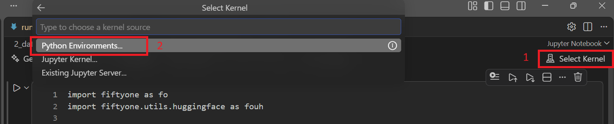
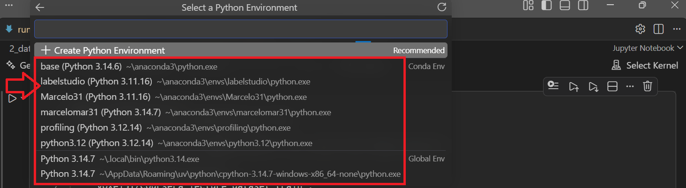

# ENVIRONMENT SETUP

### 1️⃣Install Python: https://www.anaconda.com/docs/getting-started/installation

### 2️⃣Enviroment creation in Anaconda:

```plaintext
Command: conda create -n <env_n> python=3.8 
```

### 3️⃣Activate the environment with the command:

```plaintext
conda activate <env_name>
```

### 4️⃣Install the required packages needed with the command(you can install all the packages you need, this will depend of the work you gona do):

```plaintext
pip install FiftyOne, pandas, jupyter, opencv, numpy, matplotlib, scikit scikit-image= seaborn, cvat, scipy, snorkel, pytorch, sci-kit-learn, tensorFlow
```

### 5️⃣Generate a bridge to connect the enviroment with VS Code, with the command:

```plaintext
pip install ipykernel
```

### 6️⃣Generate the path to your environment with the command:

```plaintext
python -m ipykernel install --user --name <env_name> --display-name "<env_name>"
```

### 7️⃣Open VScode go to extentions section and install: 1-Python and 2-jupyterLab extension.

### 8️⃣ In VScode select the kernel of you environment, this is important if this is not link python will not work. Look the image for guide. 1-Locate Select Kernel option, 2-Click in Python environments.



### Now you will have a list to all the environment that you have. Select the one will all the packages previously installed and done.



### 9️⃣After the set up, you can start to work in VScode in your environment with all the installed packages.
