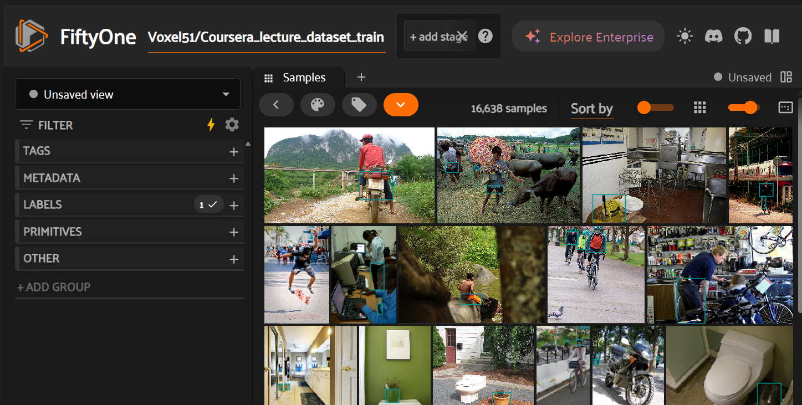
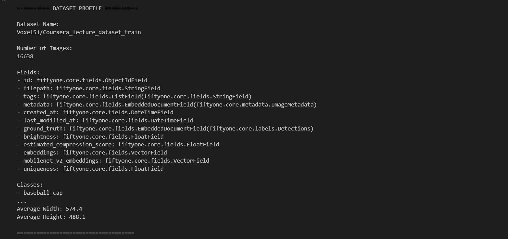

# Import libraries 

Code:

import fiftyone as fo
import fiftyone.utils.huggingface as fouh

# Load the dataset

Code:

//In this case the dataset is loaded from Huggingface
dataset = fouh.load_from_hub(
    "Voxel51/Coursera_lecture_dataset_train", 
    dataset_name="lecture_dataset_train", 
    persistent=True
    )

# Launch the App

Code:

//This will lunch FiftyOne with the dataset for a quick visual view
session = fo.launch_app(Voxel51/Coursera_lecture_dataset_train)

# Profling FityOne dataset

Code:

//The whole code will create a initial profile of the dataset
import fiftyone as fo
import fiftyone.zoo as foz
from collections import Counter

print("\n========== DATASET PROFILE ==========\n")

//This will print the Dataset name
print("Dataset Name:")
print(dataset.name)

//This will print the Dataset type
print("\nDataset Type:")
print(type(dataset).__name__)

//This will print the Dataset description
print("\nNumber of Images:")
print(len(dataset))

//This will print the Dataset tags
print("\nFields:")
for field, schema in dataset.get_field_schema().items():
    print(f"- {field}: {schema}")

//This will print the Dataset classes
classes = dataset.distinct(
    "ground_truth.detections.label"
)

//This will print the Dataset classes
print("\nClasses:")
for c in sorted(classes):
    print(f"- {c}")

//This will print the Dataset class distribution
counts = dataset.count_values(
    "ground_truth.detections.label"
)

//This will print the Dataset class distribution
print("\nClass Distribution:")
for label, count in sorted(counts.items()):
    print(f"{label}: {count}")

//This will print the Dataset metadata
print("\nComputing metadata...")
dataset.compute_metadata()

widths = []
heights = []

for sample in dataset:
    widths.append(sample.metadata.width)
    heights.append(sample.metadata.height)

avg_width = sum(widths) / len(widths)
avg_height = sum(heights) / len(heights)

print("\nImage Statistics:")
print(f"Average Width: {avg_width:.1f}")
print(f"Average Height: {avg_height:.1f}")

print("\n====================================")

# Initial Observations

-Dataset contains object detection annotations.

-Bounding boxes are available through the ground_truth field.

-Some classes appear more frequently than others.

-The dataset is suitable for annotation review and quality analysis using FiftyOne and CVAT.
