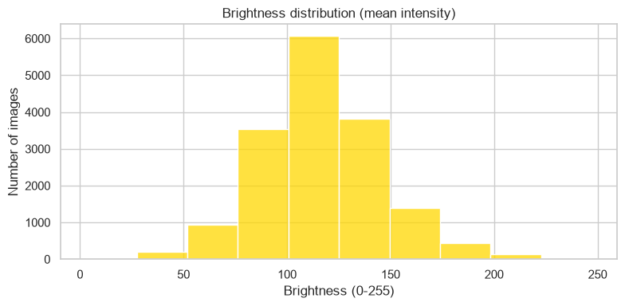
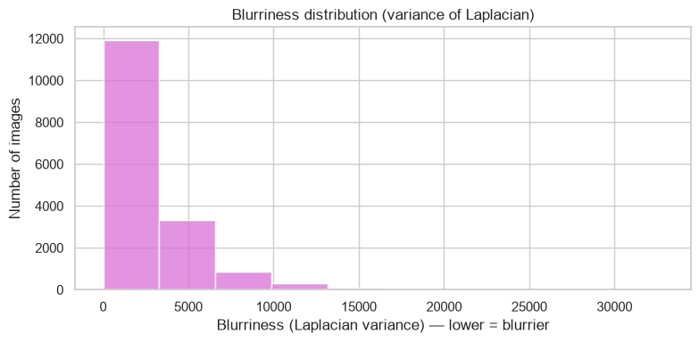
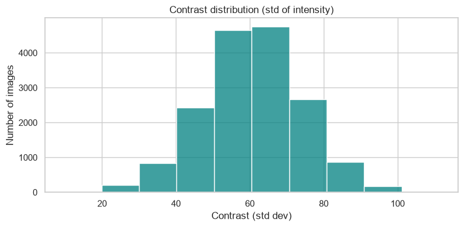

### Image quality directly affects annotation accuracy and model performance. This section evaluates brightness, blurriness, and contrast across the dataset to identify potential issues that may impact downstream tasks.

#### ☑️Dataset

It is compose of 16,638 where 210 are underexposed, 143 are overexposed, 23 are low‑contrast, and 68 are blurry. These are small fractions of the dataset and will not affect the performance of the model.

#### ☑️Brightness analysis

Most images fall into a mid‑brightness range, but a noticeable portion is underexposed. Dark images reduce labeler visibility and can cause missed objects or inaccurate bounding boxes.

Most images are mid-range in brightness clustering around mean intensities near ~75–150. Very few images are extremely dark or extremely bright, so exposure is generally acceptable.



#### ☑️Blurriness analysis

A subset of images shows high blur levels, likely due to motion or focus issues. Blurry images make object boundaries harder to identify, increasing annotation inconsistency.

The majority of images show low  blurriness, with counts falling rapidly as sharpness increases. While many images are not perfectly sharp, only a modest number exceed high‑sharpness thresholds so is acceptable.



#### ☑️Contrast analysis

Low‑contrast images reduce object separability from the background. This can lead to ambiguous annotations and lower model confidence during training.

Contrast values concentrate in a moderate range , with a bell‑shaped distribution around the dataset mean. Very low‑contrast images are rare.




# Code

```
# 1 — Install / imports (run once)
# If you already have the environment, skip installs. Otherwise uncomment the pip installs.
# !pip install fiftyone opencv-python-headless matplotlib seaborn pandas tqdm

import os
import cv2
import numpy as np
import pandas as pd
import matplotlib.pyplot as plt
import seaborn as sns
import fiftyone as fo
from tqdm.auto import tqdm

sns.set(style="whitegrid")
plt.rcParams["figure.figsize"] = (8, 4)
```

```
# 2 — Load dataset
# Replace the dataset name if needed. This uses the dataset you provided.
dataset_name = "Voxel51/Coursera_lecture_dataset_train"
print("Loading dataset:", dataset_name)
dataset = fo.load_dataset(dataset_name)
print("Number of samples:", len(dataset))
```

```
# Cell 3 — Helper functions for metrics
def compute_brightness(gray):
    # mean intensity 0-255
    return float(np.mean(gray))

def compute_contrast(gray):
    # standard deviation of intensity
    return float(np.std(gray))

def compute_blurriness(gray):
    # variance of Laplacian: lower -> blurrier
    return float(cv2.Laplacian(gray, cv2.CV_64F).var())
```

```
# 4 — Iterate samples and compute metrics
out_dir = "dataset_exploration/image_quality"
os.makedirs(out_dir, exist_ok=True)

rows = []
failed = 0

for sample in tqdm(dataset, desc="Processing images"):
    try:
        # sample.filepath should point to the image file
        fp = sample.filepath
        img = cv2.imdecode(np.fromfile(fp, dtype=np.uint8), cv2.IMREAD_COLOR) if os.name == "nt" else cv2.imread(fp, cv2.IMREAD_COLOR)
        if img is None:
            # fallback to FiftyOne loader
            img = fo.utils.data.load_image(fp)
            img = cv2.cvtColor(img, cv2.COLOR_RGB2BGR)
        gray = cv2.cvtColor(img, cv2.COLOR_BGR2GRAY)
        brightness = compute_brightness(gray)
        contrast = compute_contrast(gray)
        blurriness = compute_blurriness(gray)
        rows.append({
            "id": sample.id,
            "filepath": fp,
            "brightness": brightness,
            "contrast": contrast,
            "blurriness": blurriness,
        })
    except Exception as e:
        failed += 1
        # keep going
        rows.append({"id": getattr(sample, "id", None), "filepath": getattr(sample, "filepath", None),
                     "brightness": np.nan, "contrast": np.nan, "blurriness": np.nan})
        print("Failed for", getattr(sample, "filepath", None), ":", e)

print("Done. Failed samples:", failed)
df = pd.DataFrame(rows)
csv_path = os.path.join(out_dir, "image_quality_metrics.csv")
df.to_csv(csv_path, index=False)
print("Saved metrics to", csv_path)
```

```
# 5 — Plot histograms (10 bins) and save figures
bins = 10

# Brightness histogram
plt.figure()
sns.histplot(df["brightness"].dropna(), bins=bins, kde=False, color="gold")
plt.title("Brightness distribution (mean intensity)")
plt.xlabel("Brightness (0-255)")
plt.ylabel("Number of images")
plt.tight_layout()
plt.savefig(os.path.join(out_dir, "brightness_hist.png"), dpi=150)
plt.show()

# Contrast histogram
plt.figure()
sns.histplot(df["contrast"].dropna(), bins=bins, kde=False, color="teal")
plt.title("Contrast distribution (std of intensity)")
plt.xlabel("Contrast (std dev)")
plt.ylabel("Number of images")
plt.tight_layout()
plt.savefig(os.path.join(out_dir, "contrast_hist.png"), dpi=150)
plt.show()

# Blurriness histogram
plt.figure()
sns.histplot(df["blurriness"].dropna(), bins=bins, kde=False, color="orchid")
plt.title("Blurriness distribution (variance of Laplacian)")
plt.xlabel("Blurriness (Laplacian variance) — lower = blurrier")
plt.ylabel("Number of images")
plt.tight_layout()
plt.savefig(os.path.join(out_dir, "blurriness_hist.png"), dpi=150)
plt.show()

print("Saved plots to", out_dir)
```

```
# 6 — Simple thresholds and counts (adjust thresholds to your dataset)
# These thresholds are heuristic examples; tune them for your data.
brightness_low = 50      # underexposed
brightness_high = 200    # overexposed
contrast_low = 20        # low contrast
blurriness_thresh = 100  # below this -> likely blurry

counts = {
    "underexposed": int((df["brightness"] < brightness_low).sum()),
    "overexposed": int((df["brightness"] > brightness_high).sum()),
    "low_contrast": int((df["contrast"] < contrast_low).sum()),
    "blurry": int((df["blurriness"] < blurriness_thresh).sum()),
    "total": int(len(df))
}
print("Heuristic counts:", counts)
```
