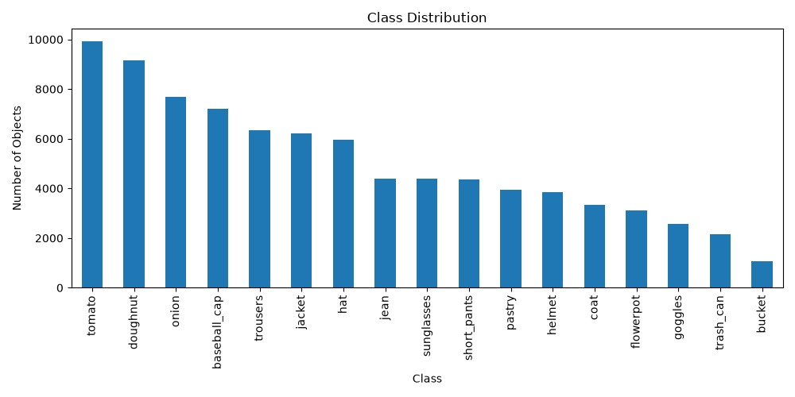
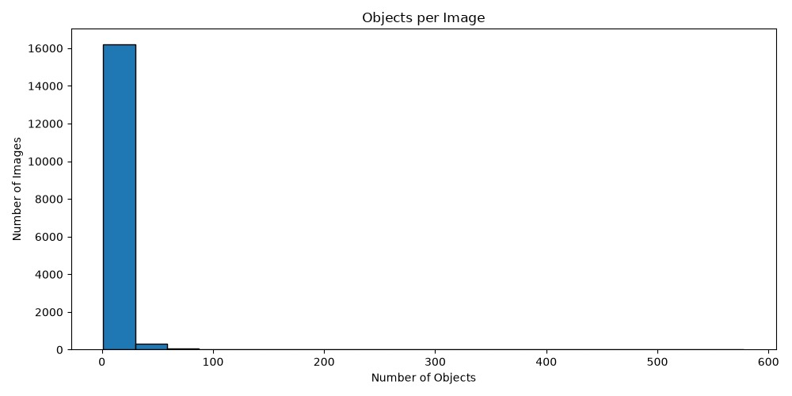
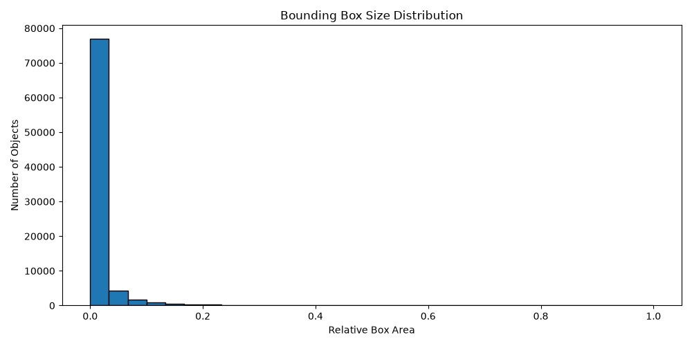

# Profling FityOne dataset


# Initial Observations

##### ☑️Dataset contains object detection annotations.

##### ☑️Bounding boxes are available through the ground_truth field.

##### ☑️Some classes appear more frequently than others.

##### ☑️The dataset is suitable for annotation review and quality analysis using FiftyOne and CVAT.

# *Code*

```
#The whole code will create a initial profile of the dataset

import fiftyone as fo
import fiftyone.zoo as foz
from collections import Counter

print("\n========== DATASET PROFILE ==========\n")

#This will print the Dataset name
print("Dataset Name:")
print(dataset.name)

#This will print the Dataset type
print("\nDataset Type:")
print(type(dataset).__name__)

#This will print the Dataset description
print("\nNumber of Images:")
print(len(dataset))

#This will print the Dataset tags
print("\nFields:")
for field, schema in dataset.get_field_schema().items():
    print(f"- {field}: {schema}")

#This will print the Dataset classes
classes = dataset.distinct(
    "ground_truth.detections.label"
)

#This will print the Dataset classes
print("\nClasses:")
for c in sorted(classes):
    print(f"- {c}")

#This will print the Dataset class distribution
counts = dataset.count_values(
    "ground_truth.detections.label"
)

#This will print the Dataset class distribution
print("\nClass Distribution:")
for label, count in sorted(counts.items()):
    print(f"{label}: {count}")

#This will print the Dataset metadata
print("\nComputing metadata...")
dataset.compute_metadata()

widths = []
heights = []

for sample in dataset:
    widths.append(sample.metadata.width)
    heights.append(sample.metadata.height)

avg_width = sum(widths) / len(widths)
avg_height = sum(heights) / len(heights)

print("\nImage Statistics:")
print(f"Average Width: {avg_width:.1f}")
print(f"Average Height: {avg_height:.1f}")

print("\n====================================")
```

# Visualization

## ✅Class distribution

Show:

-Wich classes dominate the dataset.

-Class imbalance.

-Annotation priorities.



##### *☑️The dataset is imbalanced, with a few classes like tomato appearing far more frequently than others like bucket. This means that there are more possible annotation errors in the dominant classes, also model trained on it will naturally learn those dominant classes better, unless rebalance or techniques like augmentation are applied.*

```
# Class distribution visualization

#Load the Coursera lecture dataset and launch the FiftyOne app
dataset = fo.load_dataset(
    "Voxel51/Coursera_lecture_dataset_train"
)

import matplotlib.pyplot as plt
import pandas as pd

counts = dataset.count_values(
    "ground_truth.detections.label"
)

df = pd.Series(counts).sort_values(
    ascending=False
)

plt.figure(figsize=(10,5))
df.plot(kind="bar")

plt.title("Class Distribution")
plt.xlabel("Class")
plt.ylabel("Number of Objects")

plt.tight_layout()
plt.savefig("class_distribution.png")
plt.show()
```

## ✅Object per image

Show:

-How complex are the images of objects and annotations.



##### *☑️This tells you the dataset is  densely populated with simple, low‑object scenes , while images containing many objects are  rare outliers . The model will mostly learn from images with few objects and high‑object-count images may be harder for the model because they are under‑represented.*

```
# Objects per image visualization

import matplotlib.pyplot as plt

objects_per_image = []

for sample in dataset:
    n = len(sample.ground_truth.detections)
    objects_per_image.append(n)

plt.figure(figsize=(10,5))

plt.hist(
    objects_per_image,
    bins=20,
    edgecolor="black"
)

plt.title("Objects per Image")
plt.xlabel("Number of Objects")
plt.ylabel("Number of Images")

plt.tight_layout()
plt.savefig("objects_per_image.png")
plt.show()
```

## ✅Bounding boxes size

Show:

-How crowded are the annotatios.

-More smaller boxes will show more complex images.

-Possible level of error on annotations.



##### *☑️Most objects in the dataset occupy very small areas within their images, meaning the dataset is dominated by tiny bounding boxes. This can cause errors in annotatios. Also the model will need strong small‑object detection capability and larger objects are rare, so performance on them may be weaker without targeted training.*

```
# Bounding box size distribution visualization

import matplotlib.pyplot as plt

bbox_areas = []

for sample in dataset:
    for det in sample.ground_truth.detections:

        x, y, w, h = det.bounding_box

        area = w * h

        bbox_areas.append(area)

plt.figure(figsize=(10,5))

plt.hist(
    bbox_areas,
    bins=30,
    edgecolor="black"
)

plt.title("Bounding Box Size Distribution")
plt.xlabel("Relative Box Area")
plt.ylabel("Number of Objects")

plt.tight_layout()
plt.savefig("bbox_size_distribution.png")
plt.show()
```
