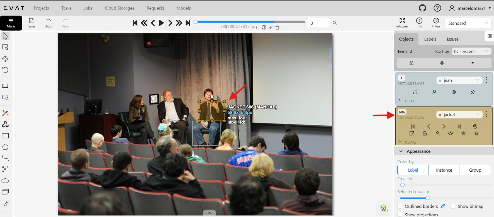
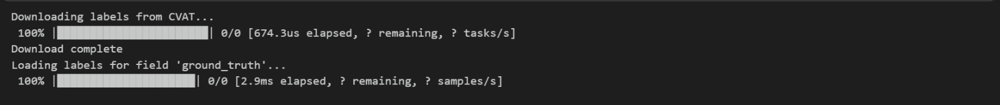

# Annotating Datasets with CVAT

**FiftyOne** and **CVAT** are two leading open-source tools, each tackling different parts of the dataset curation and improvement workflows.

The tight integration between FiftyOne and CVAT allows you to curate and explore datasets in FiftyOne and then send off samples or existing labels for annotation in CVAT with just one line of code. In order to use CVAT, you must create an account on a CVAT server.

In any case, FiftyOne will need to connect to your CVAT account. The easiest way to configure your CVAT login credentials is to store them in environment variables.

Whether you are annotating the data yourself or have a team of annotators, the workflow of uploading data from FiftyOne to CVAT is the same. The annotate() method on a collection of samples lets you specify the name, type, and classes for the labels you are annotating.

For example, let's annotate bounding boxes masks for the classes "goggles" and "sunglasses".

We'll only include a few samples to be annotated in our view for brevity. To create annotation jobs in CVAT for these samples, we simply call **annotate()**  to upload these samples and labels for analysis and/or re-annotation. assing in a unique name for this annotation run and the relevant label schema information for the annotation task. Since we'll be annotating these samples ourselves, we pass **launch_editor=True** to automatically launch a browser window with the CVAT editor open once the data has been loaded.

In this example we can see CVAT launch in action with a image example. I the right panel It is show where to select the option for introduce an annotation. After the rectangle is selects, option appears for select what label It is needed for the next annotation.


In this example can be seen that an annotation was made to delimitate a jacket. The corresponding annotation is loaded in the left panel, where different edit actions can be done.



After annotations are made and work is done in CVAT these new dataset can be export back to FityOne.



```

#Run this code to connect FiftyOne to CVAT and launch the CVAT annotation tool for annotating a small sample of the dataset.
#This will allow you to annotate images in CVAT and then import the annotations back into FiftyOne for further analysis and visualization.

import os
from getpass import getpass

os.environ["FIFTYONE_CVAT_USERNAME"] = getpass("CVAT username: username ")

os.environ["FIFTYONE_CVAT_PASSWORD"] = getpass("CVAT password: 123456789 ")

#Every time you run this code, you should change the value of the anno_key variable to a new unique identifier. This is important because it allows you to keep track of different annotation runs and their results. By using a unique identifier for each run, you can easily distinguish between different sets of annotations and avoid confusion when analyzing the results.
anno_key = "First_run_CVAT_1"


#Load the Coursera lecture dataset and launch the FiftyOne app
dataset = fo.load_dataset(
    "Voxel51/Coursera_lecture_dataset_train"
)

#Choose a sample of the dataset to upload to CVAT for annotation. This will take 100 samples from the dataset, using a seed value of 51 to ensure reproducibility. The selected samples will be used for annotation in CVAT.
small_sample = dataset.take(100, seed=51)

# Upload the samples and launch CVAT
anno_results = small_sample.annotate(
    anno_key,
    label_field="ground_truth",
    classes=['jacket', 'coat', 'jean', 'trousers', 'short_pants', 'trash_can', 'bucket', 'flowerpot', 'helmet', 'baseball_cap', 'hat', 'sunglasses', 'goggles', 'doughnut', 'pastry', 'onion', 'tomato'],
    launch_editor=True,
)
```

```
#This will load the annotations from CVAT back into the small sample dataset in FiftyOne.

small_sample.load_annotations(
    "First_run_CVAT_6",
    cleanup=True
)
```
