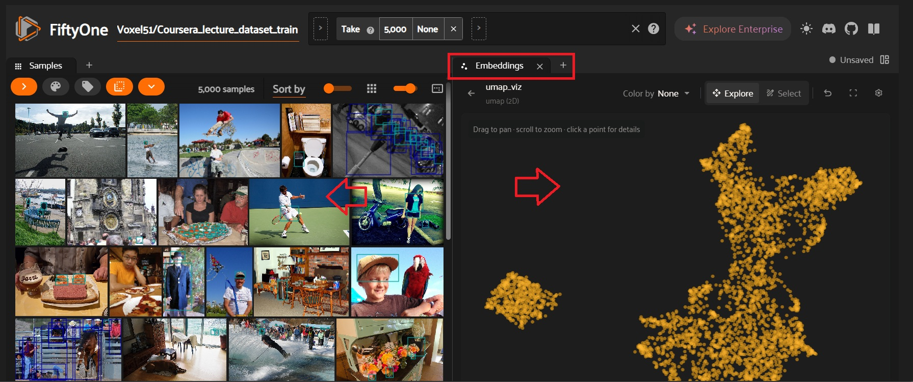
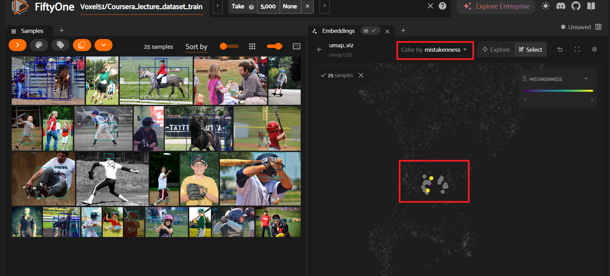
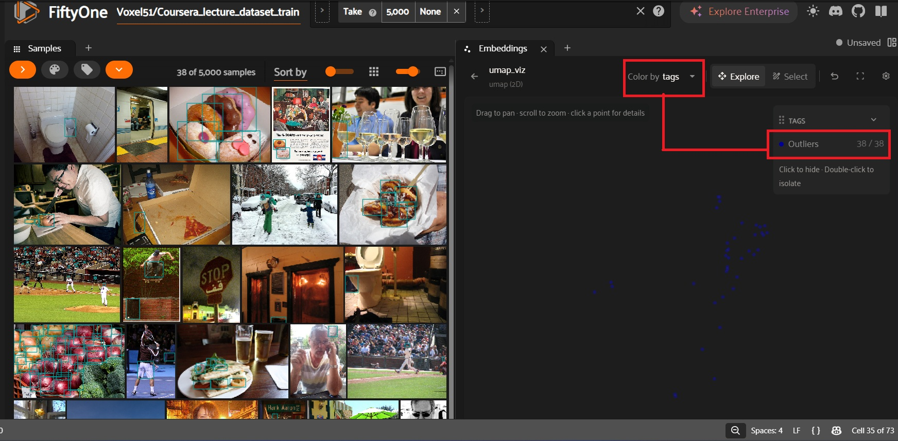
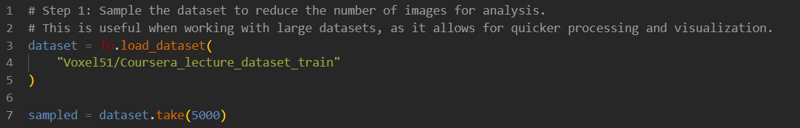
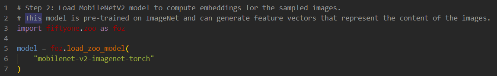
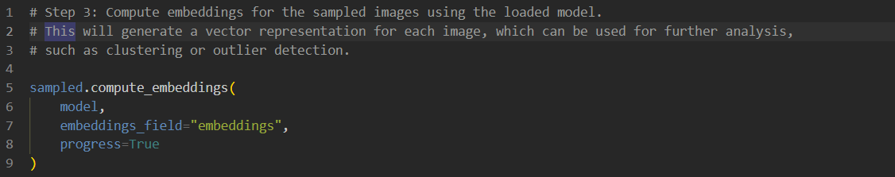
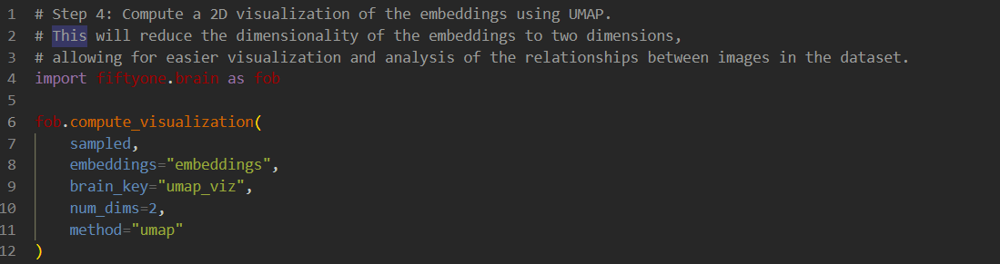
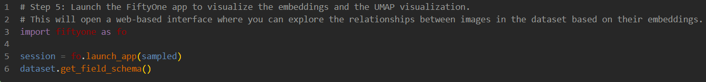

# Outliers

### ☑️Outliers in visual dataset are images that differ significantly from the majority of the dataset. These anomalies can manifest in several ways, impacting the performance of machine learning models.

*   Quality Outliers: Blurry or poorly lit images that can lead to incorrect detections.
*   Content Outliers: Images with rare objects or unusual contexts, causing models to fail in atypical scenarios.
*   Annotation Outliers: Mislabeled objects directly affecting the model's learning ability.

### ☑️Recognizing these outliers is vital for multiple reasons:

*   Improve Dataset Quality: Flagging problematic images enhances the overall quality.
*   Enhance Model Performance: Ensuring the model isn't trained on erroneous data significantly boosts its efficiency.
*   Identify Biases: Detecting outliers helps uncover potential biases, leading to fair and robust AI models.

### ☑️Embeddings are the based outliers detection because are the numerical values use to compute outliers. Embeddings are vector representations of images, to identify outliers in visual data. By analyzing the distances between these embeddings, we can detect images that are significantly different from the majority of the dataset.

### ☑️UMAP is a way to visualize in 2D the images, that will group in clusters following their values of embeddings.

### ☑️Focus on the idea:

#### ➡️Convert images into embeddings➡️Similar images cluster➡️Different images isolate themselves➡️Inspect outliers

### ☑️In this is ways is possible to analyze and find:

*   Wrong labels
*   Strange images
*   Data quality issues
*   Rare examples

### In these examples is possible look and analyze images thourgh embeddings and using a dimensionality reduction technique UMAP to find outliers and explore.

### Here is just presented the interface of FiftyOne. Where the grid is compse by 5,000 images. Note that Embeddings is selected. Then in one side we can see the images and in the other side a 2D representations of each images as a points.

### What the clusters means? The key idea is that images that look similar( with similar embedding) and up closer together. So we can think like:

*   Dense groups of points = visually similar images
*   Isolated groups = unique categories
*   Outliers(far away points) = unusual images
*

#### ➡️In this example a portion of the UMAP is selected to look for outlines. So basically we try to look for points that are far away from the cluster, in this case the green rectangle mark a group of points that are more separated. This can be look as images in the grid beside. All the images have the same theme that is people playing tennis in different scenarios, so here outliers like outliers can not bee seen clear, maybe there is different images that are not professional players that have different embeddings values, so that make them to be far away.

#### ➡️In this example note that mistakeness is selected. The UMAP is showing only the 25 selected samples, which are likely the samples you filtered because they have high mistakenness scores. Looking closer most images are baseball-related. A few are tennis, horse riding, skateboarding, or other outdoor sports. The baseball images are packed very tightly together in the embedding space. The non-baseball examples tend to be slightly farther from the core baseball cluster. Plust labes have to be analyze to because incorrect labels can cause higth mistakeness score.

#### ➡️In this example is selected color by tags and outliers specifically, so here we can see only images that differed from the cluster value of embeddings, meaning that this images are insolated. Then when we inspect the images, it's seen that all are different from one another make them unique, also we can think that they have label issues( looks they are not label correctly, and this can cause hight error score that is equal to be outlier).

### \

### ☑️Code

