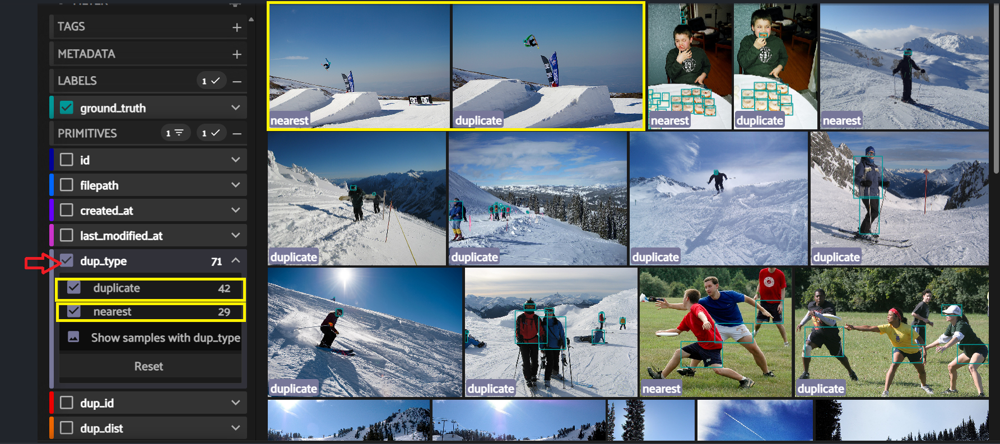

# Duplicates

### * Why duplicates harm training.

Removing exact duplicates and near-duplicates helps avoid accidental concept imbalance and ensures each sample contributes unique information to model training. Near-duplicates (very similar images or patches) are less valuable for training and can bias evaluation and validation splits.

### * Definitions: duplicate vs near-duplicate.

#### * Duplicates:

* Images with identical file contents (same filehash). These are true duplicates and are usually safe to remove or deduplicate automatically.

#### * Near-duplicates:

* Images that are visually very similar but not byte-identical (e.g., small crops, color adjustments, re-encodings). These require similarity-based detection and often a manual review before removal.

* FiftyOne compute_similarity, find_duplicates, compute_exact_duplicates

  * But first in nessesary to compute embedding:
    * What are embeddings: the computer cannot understand “image similarity” directly from raw pixels. Embeddings turn each image into a numeric vector that captures its visual meaning. Once every image has a vector, is possible to measure how close those vectors are and that is how duplicates and near‑duplicates are detected.
  * Now is possible find duplicate and near-duplicates. After that the result can be look in FiftyOne interface.

#### * Here the is a demostration in FityOne:

* The images are arrange in a way that the representative image appers frist, next to it will be the duplicate/near-duplicate image.
* This allows fast manual review and identification of rendundat samples.



### Code:

```
# Calulate embeddings for the dataset using a pre-trained model from the FiftyOne Model Zoo. 
# This will generate feature vectors for each image in the dataset, which can be used for tasks such
# as similarity search, clustering, and outlier detection.

import fiftyone as fo
import fiftyone.zoo as foz
import fiftyone.brain as fob

# load or create dataset
dataset = fo.load_dataset("Voxel51/Coursera_lecture_dataset_test")  # or fo.Dataset.from_dir(...)

# load a zoo model (example: mobilenet_v2)
import fiftyone.zoo as foz

dataset = fo.load_dataset("Voxel51/Coursera_lecture_dataset_test")

model = foz.load_zoo_model("mobilenet-v2-imagenet-torch")

emb_field = "mobilenet_v2_embeddings"
dataset.compute_embeddings(
    model,
    embeddings_field=emb_field,
    batch_size=32,
)

# Verify embeddings were coputed
print(dataset.first()[emb_field].shape)
```

```
#Creation of a similarity index for the dataset using the computed embedding.
#This index will allow for efficient retrieval of similar images based on their embeddings, 
#enabling tasks such as similarity search and duplicate detection.
#Afte that the session is lunch in fityOne. 
import fiftyone as fo
import fiftyone.brain as fob

#Build a similarity index for the dataset using the computed embeddings. 
#This index will allow for efficient retrieval of similar images based on their embeddings, 
#enabling tasks such as similarity search and duplicate detection.
similarity_index = fob.compute_similarity(
    samples=dataset,
    embeddings=emb_field,
    backend="sklearn",
    brain_key="similarity_index_1",  # use a unique key;
    metric="cosine",
)

#This will identify duplicate images in the dataset based on their embeddings.
#The fraction parameter specifies the threshold for considering two images as duplicates.
#In this case, a fraction of 0.01 means that images with a similarity score above 0.99 will be considered duplicates.
#The function will return a list of pairs of images that are considered duplicates based on the specified threshold.
similarity_index.find_duplicates(fraction=0.01)

#This will create a view of the dataset that contains only the duplicate images identified by the find_duplicates() function. 
#The duplicates_view will include the type of duplicate (dup_type), the ID of the duplicate image (dup_id),
#and the distance between the embeddings of the duplicate images (dup_dist). This view can be used to visualize and analyze the duplicate images in the dataset.
duplicates_view = similarity_index.duplicates_view(
    type_field="dup_type",
    id_field="dup_id",
    dist_field="dup_dist",
)


session = fo.launch_app(duplicates_view)
```
