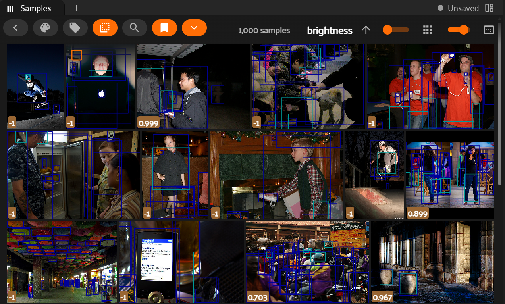
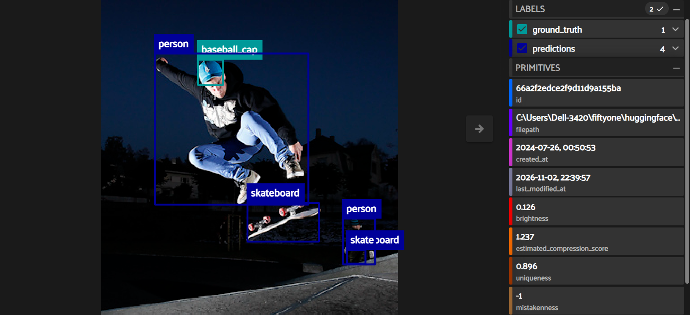
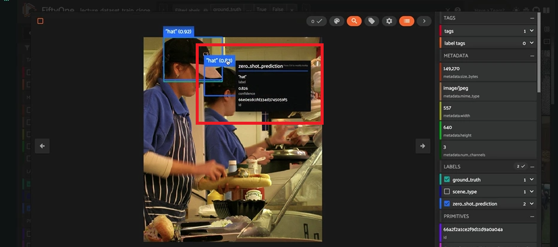
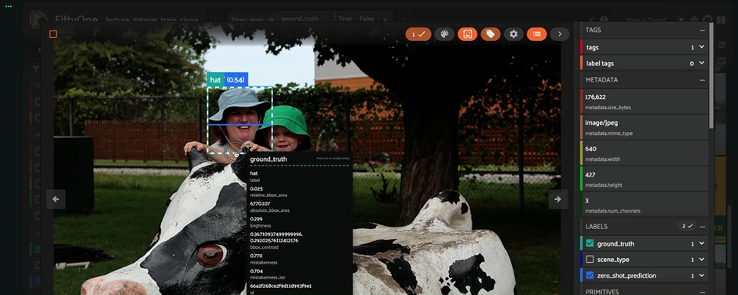
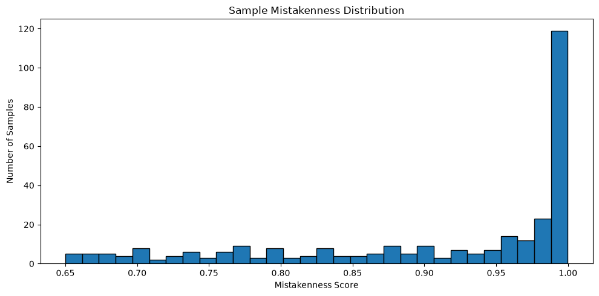

# Compute mistakennes

#### Now we're ready to assess the mistakenness by use AI-assisted tools to identify potentially lack or incorrect annotations and prioritize human review, compare wtih ground truth detections values.

#### We can do so by running the compute\_mistakenness() method from the FiftyOne Brain. Since we are using model predictions to guide the mistakenness process, the better the model, more accurate will be mistakenness suggestions.

## Step 1

#### A model will be use to generate predictions for us, in this case is "faster-rcnn-resnet50-fpn-coco-torch" that is available through the FifyOne model zoo.

#### The model was trained on the COCO dataset and can detect 80 common object categories. Generated predictions were compared against the dataset's ground-truth annotations using FiftyOne Brain's mistakenness analysis to identify potentially incorrect, missing, or incomplete annotations.

```plaintext
Code:
```

## Step 2

#### No will comput mistakennes, that is a comparison between: Ground truth lables Vs Model predictions.

```plaintext
Code:
```

## Step 3

#### Now will have new fields in the fiftyOne interface:

| Field | Meaning |
| --- | --- |
| Mistakenness | Possible wrong class label |
| Mistakenness\_loc | Possible bad bounding box location |
| Possible\_missing | Object predicted by model but missing in GT |
| Possilbe\_spurious | Ground truth object may not exist<br><br> |

## View the worst images

#### After we have the values of mistakennes it is possible lunch FityOne and inspect the images. Here are shown the top 10 most suspicious images (Note: this was made for a subnet of images = 1000, because It take to long to compute).



#### By secting the first image we can observe that during mistakenness analysis, FiftyOne identified an image containing three possible missing annotations. The ground-truth labels contained only a baseball cap annotation, while the model detected additional objects, including a person and skateboard. Visual inspection suggests that several prominent objects may not have been annotated at all.



```plaintext
Code:import fiftyone as fo#Find the worst samples in the dataset based on their mistakenness scores. This will sort the samples in descending order of mistakenness, allowing you to identify the samples that are most likely to be misclassified by the model.
mistake_view = subset.sort_by(
"mistakenness",
reverse=True
)session = fo.launch_app(mistake_view)
```

#### In this example It is show an image with a hight mistakenness, where the error is a possible class label. When click in the label for the hat, It's show that values are missing.



```plaintext
Code:from fiftyone import ViewField as F
import fiftyone as fomissing_view = subset.match(
F("possible_missing") > 0.95
)session = fo.launch_app(missing_view)
```

#### In this example It is show an image with a hight mistakenness\_loc, so we are looking the field "Mistakennes\_loc", where the error is a possible bad bounding location. When click in the label for the hat, It's show that the bounding box for the hat is mix with the face of the person.

#### 

```javascript
Code:from fiftyone import ViewField as F
import fiftyone as fohigh_mistaken_loc_view = dataset.filter_labels("ground_truth", F("mistakenness_loc") > 0.51)session = fo.launch_app(missing_view)
```

## Histogram

#### Here we can see a spike for mistakenness score near 1.0 indicates a strong disagreement between the model predictions and the ground-truth annotations.

#### This means that among the samples where FiftyOne was able to compute a valid score: many were flagged as highly suspicious they should be prioritized for manual review they may contain missing objects, incorrect labels, or annotation inconsistencies

## 

```plaintext
Code:
```

### Some statistics

| Name | Value |
| --- | --- |
| Valid samples | 309 |
| Min | 0.6500455141067505 |
| Mean | 0.9074842429276809 |
| Median | 0.9646666347980499 |
| Max | 0.9999004304409027 |
| Samples>0.95 | 168 |

#### Of a subset of 1,000 images was analyzed, 309 samples received valid mistakenness scores. The average mistakenness score was 0.907, while the median score was 0.965.

#### More than half of the scored samples (168 images, 54.4%) had a mistakenness score greater than 0.95, indicating strong disagreement between model predictions and existing annotations. Indicating potential annotation issues such as missing objects, incorrect labels, and localization errors.

```plaintext
Code:import numpy as np
print("Valid samples:", len(mistakenness_scores))
print("Min:", np.min(mistakenness_scores))
print("Mean:", np.mean(mistakenness_scores))
print("Median:", np.median(mistakenness_scores))
print("Max:", np.max(mistakenness_scores))
print(
"Samples > 0.95:",
sum(score > 0.95 for score in mistakenness_scores)
)
```
