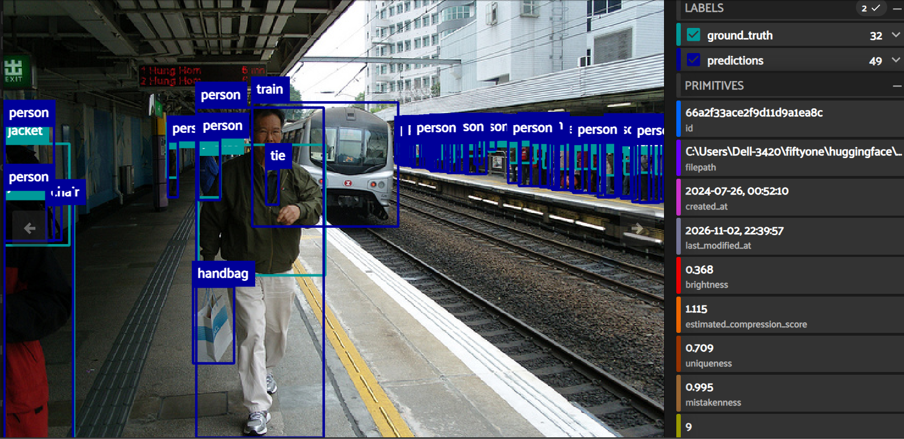
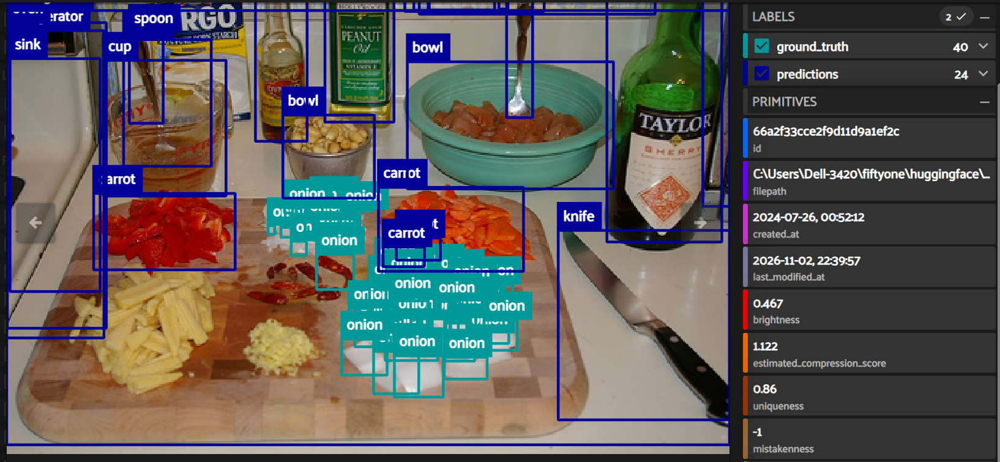
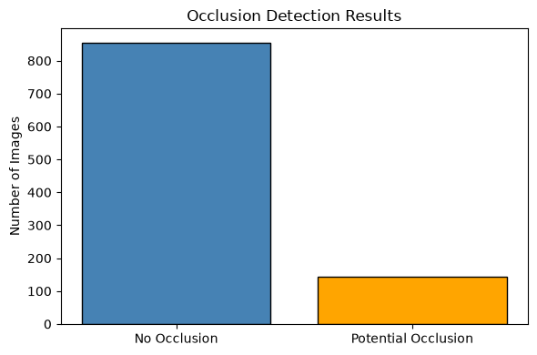
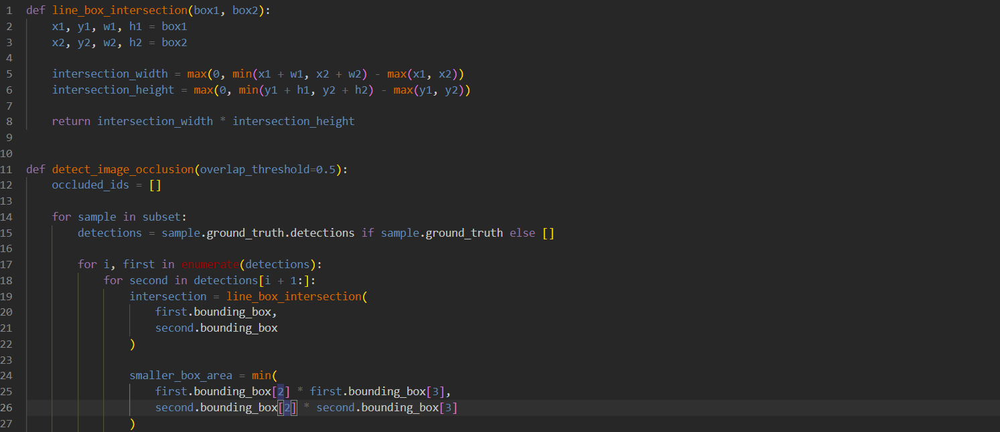
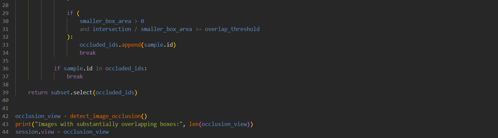
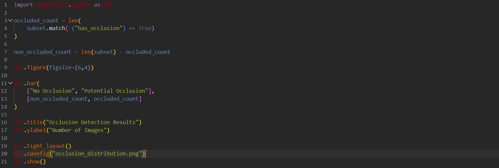

# Occlusion

### \#### Occlusion occurs when an object is partially hidden by another object. For example: a person behind a car, a bicycle behind a fence or a traffic sign partially covered by a tree. Occluded objects are more difficult to annotate consistently and may lead to annotation errors.

### ☑️Occlusion image example

#### This train station image contains a dense collection of small and distant people. Ground-truth annotations include 32 objects, while the object detection model generated 49 detections.

#### The scene presents several annotation challenges:

#### \* Multiple overlapping people.

#### \* Partially visible individuals.

#### \* Small object sizes.

#### \* Long viewing distances. These characteristics increase annotation difficulty and may lead to inconsistencies between human annotations and model predictions. The sample received a mistakenness score of 0.995, making it a strong candidate for manual quality review.

### ☑️Overlapping objects example

#### This image contains a dense cluster of onion annotations. Ground-truth labels include 40 annotated objects, whereas the object detection model generated 24 predictions.

#### Visual inspection shows that many onion instances overlap or are partially obscured by neighboring objects. The high object density makes it difficult to distinguish individual instances, creating a challenging annotation scenario.

#### This example illustrates how occlusion and object overlap can affect both annotation consistency and model performance.

### ☑️Histogram

#### Finally we will analyze occlusion with a histogram. That shows: no occlusion: 855 images (85.5%) and potential occlusion: 145 images (14.5%). The flagged images should be manually reviewed to identify crowded scenes, overlapping objects, and partially visible objects that may increase annotation errors.

### ☑️Code for Occlusion:

### ☑️Code for histogram:

