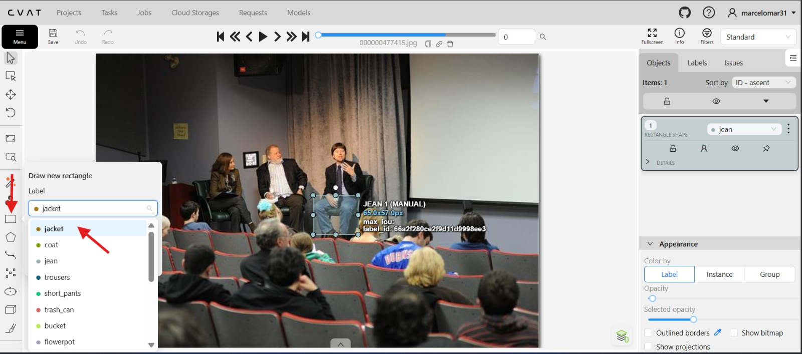

# Data labeling showcase using FiftyOne and CVAT
This repository will showcase: dataset inspection, annotation workflows, and exports between FiftyOne and CVAT.  

1-Load and inspect datasets

2-Evaluate annotation quality

3-Find labeling issues

4-Work with FiftyOne

5-Use CVAT

6-Review and correct annotations

7-Prepare datasets for annotation projects

9-Document your workflow professionally

